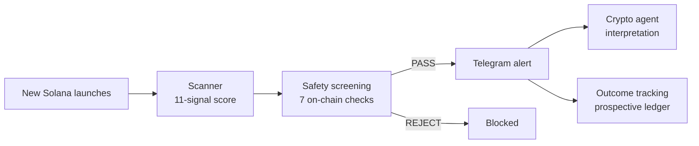

# Vivameda Blockchain (Crypto Lab)

Research on Solana meme and small-cap tokens: discovery, safety screening, alerts and prospective outcome studies. This repository holds no trading keys and executes no trades. Every study is preregistered and published with its limits, including the results that did not work.

## Running now

Status as of 17 October 2026.

| Component | What it does | Status |
|---|---|---|
| [Scanner](scout/early_scout.py) | Finds Solana launches 30 minutes to 6 hours old at $30k to $750k market cap, scores them on 11 transparent signals, alerts on Telegram | Running |
| [Safety screening](scout/SCREENING_V2.md) | Seven checks before any alert: mint and freeze authority, pool and LP authenticity, real sells by distinct wallets, holder concentration, creator behaviour, linked-wallet clusters, wallet age. Any explicit REJECT blocks the alert. | Running |
| [Monitors](docs/MONITORS.md) | Pool liquidity and watchlist observation alerts | Running |
| [Crypto agent](agent/) | Interprets alerts with a [runner knowledge pack](research/runner-study-20261011/AGENT_KNOWLEDGE.md): phase, audience, demand, exhaustion | Running |
| [Prediction ledger](research/) | Frozen prospective cohort; closes at 200 eligible tokens or 3 November 2026 | Collecting |
| [Early lane v1](early_lane/STATUS.md) | Alerts for Pump.fun tokens at $8k to $25k with fail-closed holder and buyer checks, plus 24-hour outcome tracking. Rules frozen for 14 days before the first alert. | RPC repair applied; running log-only; two-hour validation pending. [Sender built](early_lane/sender/README.md), previous bundle installed/stopped; same scanner private chat + 🌻 test succeeded; automatic delivery off. |
| [Meme desk v1](meme_desk/STATUS.md) | Trade tickets and exit-rule replay for human-executed flips | Paused |
| [Copy paper experiment](copy_trading/README.md) | Delayed copying of verified wallets, on paper | Waiting for verified wallets |

## What we have learned so far

**The first fitted model lost to the base rate.** A seven-feature logistic model trained on 42 tokens and tested on 18 later ones scored Brier 0.110 against 0.100 for simply predicting the base rate, and log loss 0.443 against 0.359. It was published as a negative result and never used for alerts. The scanner stays a transparent rule count, not a probability. [Details](research/README.md).

**Peaks are not profits.** Outcome labels record the highest multiple a token reached. A later buyer cannot sell at the peak, so these figures are kept separate from anything that could be called realized return. No profitable execution has been established.

**Screening is the most mature part.** Several common failure modes are visible on chain before an alert: authorities not revoked, liquidity that can be pulled, concentrated or linked holders, creators with a history. The scanner only alerts when those checks pass. That reduces exposure to these risks; it does not prove a token is safe.

**Copying "successful" wallets is harder than it looks.** The copy experiment admitted no wallet yet: social-media attributions could not be verified. We also expect many attractive wallets to profit from being first, which a delayed follower cannot copy; that is a hypothesis to test, not a finding. A historical copyability screen comes before any wallet is admitted.

## How it works



## How studies are run

- Rules, cohorts and evaluation are frozen and committed before outcomes exist.
- Frozen cohorts are never re-selected after looking at results; missing data stays missing.
- Each component has its own state, installer and tests; one component never changes another's data.
- Paper and observation only. Keys, signing and execution are outside this repository.

What is published and what is not: [publication policy](PUBLICATION_POLICY.md).

## Verify

Use Python 3.12; frozen scorer contracts are version-bound.

```sh
python3.12 -m venv .venv
.venv/bin/python -m pip install -r requirements.txt -r research/requirements.txt
.venv/bin/python scripts/verify_release.py
```

The verifier checks every file against MANIFEST.json and runs each test directory in isolation.

## Repository layout

| Path | Contents |
|---|---|
| `scout/` | Scanner, screening, wallet evidence and tests |
| `monitors/` | Independent watchlist and pool monitors |
| `agent/` | Crypto agent and bounded interpretation |
| `learning/`, `research/` | Daily learning, frozen studies, shadow models, published baseline |
| `early_lane/`, `meme_desk/`, `copy_trading/` | Newer experiments, each isolated |
| `deploy/`, `scripts/` | Service templates and release utilities |
| `docs/` | Explanations, dated releases and history |

Start with the [repository map](docs/REPOSITORY_MAP.md) for detail.

## History

The previous README with full release notes: [docs/history/README_THROUGH_20261017.md](docs/history/README_THROUGH_20261017.md). Earlier: [docs/history/README_THROUGH_20261011.md](docs/history/README_THROUGH_20261011.md).

No licence has been granted: the source is visible for review, all rights reserved.
